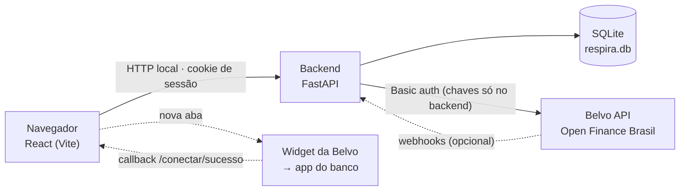

# Respira

> **Descubra quando você sai das dívidas.**
> Projeto do **Enterprise Challenge / Startup One** do curso de **Engenharia de Software da FIAP**
> (4º e último ano) — protótipo funcional da Fase 6.

O Respira lê as dívidas de uma pessoa via **Open Finance** (pela [Belvo](https://belvo.com)),
calcula **quando ela fica livre delas** e propõe um plano de quitação que cabe no bolso.
A unidade de valor do produto é **uma data**, não um gráfico: todo app financeiro responde
"para onde foi meu dinheiro"; o Respira responde **"quando isso acaba"**.

### Sobre este projeto

O Respira é o projeto da equipe abaixo para o **Enterprise Challenge / Startup One** do
**4º e último ano de Engenharia de Software da FIAP**. A Fase 5 validou o problema, a persona e
o modelo de dados (com o motor de plano em Oracle PL/SQL); esta Fase 6 entrega o protótipo
funcional, integrado a dados bancários reais.

| Integrante | RM |
|---|---|
| André Lambert | 99148 |
| Gabriel Augusto Maciel Toledo | 551654 |
| Ruan Rocha | 551520 |
| Gustavo Kenzo | 98481 |
| Lorenzo Ferreira | 97318 |

---

## Sumário

1. [O problema](#1-o-problema)
2. [O que construímos](#2-o-que-construímos)
3. [Como rodar](#3-como-rodar)
4. [Roteiro de avaliação (5 minutos)](#4-roteiro-de-avaliação-5-minutos)
5. [Arquitetura](#5-arquitetura)
6. [Stack](#6-stack)
7. [O motor de plano](#7-o-motor-de-plano)
8. [Segurança e privacidade](#8-segurança-e-privacidade)
9. [Testes](#9-testes)
10. [Limitações atuais](#10-limitações-atuais)
11. [Próximos passos](#11-próximos-passos)
12. [Documentação e referências](#12-documentação-e-referências)

---

## 1. O problema

No Brasil, 82% das famílias estão endividadas (PEIC/CNC), 85% dessas dívidas estão no cartão
de crédito, e o rotativo cobra mais de 400% ao ano (BCB). O problema não é falta de informação —
é **ausência de horizonte**: a pessoa sabe que deve, mas não sabe *quanto no total*, *o que pagar
primeiro* e *quando isso acaba*.

A persona do projeto é a **Juliana Ramos** (fictícia, ancorada em dados públicos): 34 anos,
R$ 3.100 líquidos, cinco dívidas espalhadas em bancos e carnês. Os números dela escondem a
armadilha que o Respira existe para mostrar: **os juros do mês (R$ 733) são maiores que a soma
dos mínimos (R$ 723)** — pagando só o mínimo de tudo, a dívida dela cresce todo mês.

O contexto completo (pesquisa, persona, princípios, regras de negócio) está em
[`docs/contexto-produto.md`](docs/contexto-produto.md).

---

## 2. O que construímos

Um aplicativo web *mobile-first* (pensado para Android intermediário, telas de 360 px) com
backend próprio, que roda contra a **Belvo em produção** — dados bancários reais — e também em
um **modo demonstração** com a Juliana, que não precisa de nenhuma credencial.

| Funcionalidade | O que faz | Situação |
|---|---|---|
| **F1 — Conexão de contas** | Autorização via widget da Belvo (Open Finance Brasil), aberto em nova aba; coleta de contas, cartões, faturas, empréstimos e transações; acompanhamento da coleta em tempo real; revogação em um toque. Dívidas fora do Open Finance (carnê, crediário) entram por cadastro manual assistido. | ✅ Implementado |
| **F2 — Raio-X da dívida** | Total consolidado, lista ordenada por custo efetivo (taxa ao ano), data de quitação projetada na mesma tela e o alerta explícito *"pagando só o mínimo, sua dívida cresce R$ 10 por mês"*. | ✅ Implementado |
| **F3 — Plano de quitação** | Três estratégias lado a lado (Avalanche, Bola de neve, Equilibrado), com a diferença traduzida em reais e meses, e um *slider* de capacidade mensal que move a data em tempo real. | ✅ Implementado |
| **F4 — Acompanhamento e alertas** | Detecção determinística de eventos (entrada no rotativo, atraso iminente, atraso confirmado, cheque especial, pico de gasto, desvio do plano, dívida quitada), previsto × realizado mês a mês e marcos celebrados. Só há alerta quando existe uma ação concreta e um valor em reais em jogo. | ✅ Implementado (alertas dentro do app; sem push/e-mail) |
| **F5 — Microlições e copiloto** | 9 microlições estáticas, casadas por regra com o evento detectado. O copiloto de IA aparece **desabilitado, com rótulo "em breve"** — nenhuma resposta de IA é simulada. | 🟡 Estrutura pronta; IA não implementada |
| **Contas (visão financeira)** | Saldos por banco, faturas de cartão (com pagamentos e mínimo), extrato paginado com filtros, categoria, horário e tipo de operação de cada transação. | ✅ Implementado |

**Modo demonstração (Juliana).** Simula a jornada inteira com dados fictícios no **mesmo formato
de resposta da Belvo** (o mapeamento Belvo → domínio é exercitado de verdade): conexão por um
widget simulado, coleta, Raio-X, plano e acompanhamento. A tela inicial dela tem controles para
**avançar um mês** (inclusive um "mês difícil", para ver o plano se recalcular sem linguagem de
falha) e **reiniciar a demonstração**.

---

## 3. Como rodar

### Pré-requisitos

| Ferramenta | Versão | Observação |
|---|---|---|
| [uv](https://docs.astral.sh/uv/) | recente | gerencia o Python do backend; instala o Python 3.12+ sozinho se precisar |
| Node.js | 20.19+ ou 22.12+ | exigência do Vite |

Testado em macOS com Python 3.13, Node 26 e uv 0.12.

### Passo a passo

```bash
# 1) Configuração do backend (uma vez só)
cp backend/.env.example backend/.env

# 2) Backend — FastAPI + SQLite (cria o banco, aplica as migrações e semeia a Juliana ao subir)
cd backend
uv run uvicorn app.main:app --reload --port 8000

# 3) Frontend — em outro terminal
cd frontend
npm install
npm run dev
```

Abra **http://localhost:5173**. A documentação interativa da API fica em http://localhost:8000/docs.

> O arquivo `frontend/.env.example` já traz os valores padrão; copiar para `frontend/.env` só é
> necessário se o backend rodar em outra porta.

### Entrar com a conta de demonstração

Na tela de login, clique em **"Entrar como Juliana (demonstração)"**, ou use:

| | |
|---|---|
| **E-mail** | `juliana@respira.example` |
| **Senha** | `senha123` |

Essas credenciais **não são segredo**: a Juliana é uma persona fictícia, os dados dela são
gerados pelo código (`backend/app/providers/fixture.py`) e a conta só existe no banco local de
quem roda o projeto. Elas vêm de `DEMO_EMAIL`/`DEMO_SENHA` no `backend/.env` — o código não tem
nenhuma credencial embutida.

### O que funciona para quem clona o repositório

| Cenário | Funciona? | Por quê |
|---|---|---|
| Conta demo (Juliana) | ✅ Sim, sem configurar nada além do passo 1 | Dados fictícios gerados pelo próprio backend |
| Criar uma conta nova | ✅ Sim | Cadastro, login e telas funcionam normalmente |
| Conectar um banco real | ❌ Não, sem chaves próprias | Exige `BELVO_SECRET_ID`/`BELVO_SECRET_PASSWORD`, que **não estão no repositório** (ver abaixo). Sem elas, a tela de conexão avisa que a integração não está configurada |

**Por que as chaves da Belvo não estão no repositório.** O projeto tem acesso à Belvo em
**produção** — as chaves dão leitura a dados financeiros reais de quem conectar um banco.
Publicá-las seria um comprometimento de segurança (e violaria as regras do próprio projeto,
§12 da especificação). Elas ficam apenas no `backend/.env` de quem desenvolve, que o Git ignora.
Quem tiver uma conta Belvo própria pode preencher as variáveis no `backend/.env` e reiniciar o
backend; o fluxo real fica disponível para qualquer conta registrada.

**O banco de dados também não vai para o Git.** O arquivo `backend/respira.db` contém dados
bancários reais de quem testou com a Belvo. Ele é recriado do zero na primeira subida, já com a
Juliana — os dados dela vêm do código, não do banco.

### Testes

```bash
cd backend && uv run pytest     # 78 testes
cd frontend && npm test         # 30 testes
```

---

## 4. Roteiro de avaliação (5 minutos)

Com o backend e o frontend no ar, entrando como Juliana:

1. **Raio-X** — "Você deve **R$ 8.260** em **5 compromissos**", a lista ordenada pela taxa ao ano
   (o rotativo aparece com **436% a.a.**), a data de quitação logo abaixo e o alerta de que,
   pagando só o mínimo, a dívida **cresce R$ 10 por mês**.
2. **Plano** — as três estratégias lado a lado. Com R$ 900/mês: Avalanche quita em **18 meses**
   (R$ 7.924 de juros), Equilibrado em **19** (R$ 8.240), Bola de neve em **21** (R$ 10.492).
   Arraste o *slider* e veja a data se mover. Ative um plano.
3. **Início** — o que pagar este mês, alertas pendentes e o painel de demonstração: avance um mês
   (ou um "mês difícil") e veja o previsto × realizado e a data recalculada.
4. **Contas** — saldos, faturas do cartão (com pagamentos e mínimo) e extrato com detalhes de cada
   transação.
5. **Configurações** — o que o app lê e o que não lê, revogação por banco e exclusão de conta
   (esta última desabilitada na conta demo).

---

## 5. Arquitetura



**Decisões principais:**

- **Existe um backend porque as chaves da Belvo nunca podem estar no navegador.** Qualquer chave
  num bundle de frontend é legível no DevTools. Toda chamada à Belvo sai do backend; o React só
  conversa com a nossa API.
- **O widget abre em nova aba, não em `iframe`.** O passo seguinte ao widget é o site do banco,
  e bancos bloqueiam ser enquadrados. A aba original fica sabendo do resultado por
  `BroadcastChannel` **e** por consulta periódica ao backend — a fonte de verdade é o servidor.
- **Coleta por polling, webhooks opcionais.** A Belvo avisa por webhook quando os dados estão
  prontos, mas `localhost` não recebe chamadas da internet. Por padrão o backend consulta a Belvo
  periodicamente; com um túnel público configurado, os webhooks (autenticados e idempotentes)
  assumem.
- **Provedor por usuário.** A conta demo usa o `FixtureProvider` (dados fictícios no formato da
  Belvo); toda conta registrada usa o `BelvoProvider`. As duas implementam a mesma interface, e o
  resto do sistema não sabe qual está em uso.
- **Camadas com responsabilidades fechadas** — o que torna a troca de banco de dados barata:

```
backend/app/
├── domain/        regras de negócio em Python puro, sem I/O (motor de plano, Raio-X, eventos)
├── providers/     Belvo real, fixture da Juliana e mapping.py — único lugar que conhece os nomes da Belvo
├── repositories/  única camada que conhece SQL
├── services/      orquestração (coleta, conexão, autenticação, demo)
├── routers/       endpoints HTTP
└── models/        tabelas (SQLModel) · migrações em backend/migrations (Alembic)

frontend/src/
├── routes/        uma pasta por tela
├── components/    componentes de interface e do domínio (Money, LogoBanco, gráficos)
└── lib/           cliente da API validado com Zod, dinheiro em centavos, datas, textos (copy.ts)
```

**Banco de dados.** SQLite em um único arquivo (`backend/respira.db`), com 17 tabelas de domínio
(usuário e sessão, consentimento e coleta, contas, faturas, transações, dívidas, planos, eventos,
lições, log de webhooks). O esquema é versionado com Alembic e aplicado automaticamente na
subida. Os nomes de tabelas e valores de enum seguem o esquema Oracle entregue na Fase 5, para
que a migração futura seja mecânica.

---

## 6. Stack

| Camada | Tecnologia |
|---|---|
| Frontend | React 18 + TypeScript (strict), Vite, Tailwind CSS, React Router, TanStack Query, React Hook Form + Zod, Recharts, date-fns (pt-BR) |
| Backend | Python 3.12+, FastAPI, SQLModel/SQLAlchemy, Alembic, Pydantic v2, pydantic-settings, httpx, argon2-cffi |
| Banco | SQLite (protótipo) — Oracle Autonomous Database planejado |
| Integração | Belvo — Open Finance Brasil (OFDA): widget, `token`, `links`, `consents`, `accounts`, `transactions`, `bills`, `owners`, `institutions` e, quando habilitados na conta, `incomes` e `recurring-expenses` |
| Testes | pytest (backend), Vitest + Testing Library (frontend) |

**Dinheiro nunca é float.** O backend usa `Decimal` (gravado como texto exato no banco) e o
frontend trabalha em centavos inteiros.

---

## 7. O motor de plano

O núcleo do produto (`backend/app/domain/planner.py`) é um **porte fiel** do pacote PL/SQL
`PKG_PLANO` validado na Fase 5:

1. **Capacidade de pagamento** — calculada do histórico, não perguntada: mediana das entradas
   menos mediana dos gastos essenciais dos últimos 6 meses, **com 10% de reserva** para
   imprevistos. O usuário pode ajustar pelo *slider*.
2. **Ordenação por estratégia** — Avalanche (maior taxa primeiro), Bola de neve (menor saldo
   primeiro) ou Equilibrado (a menor dívida primeiro, para gerar tração, e depois por taxa).
3. **Simulação mês a mês** — juros incidem antes do pagamento, arredondados a cada mês; paga-se o
   mínimo de tudo e a sobra vai inteira para a dívida da vez.

O teste `backend/tests/test_planner.py` reproduz **ao centavo** os números publicados na Fase 5
para a Juliana (18 / 19 / 21 meses). A estratégia pré-selecionada é Avalanche — ou Equilibrado
para quem já desistiu de um plano antes —, decisão marcada como provisória no código porque veio
de uma pesquisa com apenas 10 respostas.

---

## 8. Segurança e privacidade

O protótipo lida com dados financeiros reais, então foi tratado como produção:

- **Nenhum segredo no código nem no Git.** Chaves da Belvo e configuração ficam em `backend/.env`
  (ignorado pelo Git); o `.env.example` traz só os nomes das variáveis.
- **Nenhuma chamada à Belvo parte do navegador.**
- **Senhas com argon2id**; sessão em cookie `HttpOnly`/`SameSite=Lax`, com o token guardado no
  banco apenas como hash; limite de tentativas de login.
- **CORS restrito** à origem do frontend e cabeçalho obrigatório nas requisições de escrita
  (proteção contra CSRF).
- **Minimização de dados**: o consentimento pede só as quatro permissões que o produto usa; do
  cartão, guarda-se apenas o final (4 dígitos); CPF aparece sempre mascarado na interface; os logs
  foram escritos para não registrar CPF, tokens, segredos nem saldos.
- **Webhook autenticado** (token Bearer, comparação em tempo constante) e idempotente.
- **Revogação real**: desconectar um banco apaga o vínculo na Belvo **e** os dados locais.
  A pessoa também pode excluir a própria conta.

---

## 9. Testes

| Suíte | Quantidade | O que cobre |
|---|---:|---|
| `backend/tests/test_planner.py` | 20 | Os números da Fase 5, empates, uma dívida só, capacidade insuficiente, ausência de dívidas |
| `backend/tests/test_mapping.py` | 40 | Belvo → domínio: modalidades, normalização da taxa de juros, faturas, transações, fuso horário |
| `backend/tests/test_api.py` | 10 | Jornada da Juliana pela API, autenticação, isolamento entre usuários, webhooks |
| `backend/tests/test_belvo.py` e `test_instituicoes.py` | 8 | Cliente da Belvo (payload do token, paginação, erros) e catálogo de bancos |
| Frontend (Vitest) | 30 | Dinheiro em centavos, validação de CPF/e-mail, textos, datas, cadastro |

---

## 10. Limitações atuais

**Para rodar:**

- **Conexão bancária real exige chaves próprias da Belvo** — as do projeto não são publicadas
  (ver [§3](#o-que-funciona-para-quem-clona-o-repositório)). Quem clona avalia o produto pela
  conta demo.
- **Roda só localmente.** O protótipo não está publicado; publicar com dados financeiros reais
  exigiria cofre de segredos, HTTPS e outra discussão de segurança.
- **Webhooks exigem URL pública** (túnel ngrok/Cloudflare registrado no painel da Belvo). Sem
  isso, a coleta usa *polling* — funciona, mas é menos eficiente.

**Do produto e dos dados:**

- **O Open Finance só traz o que a pessoa conectar.** Cada consentimento é de uma instituição;
  um empréstimo no Banco X só aparece se o Banco X for conectado. Ficam de fora carnês e
  crediários, dívidas com pessoas e — importante para a persona — **dívidas já cedidas a empresas
  de cobrança**. O cadastro manual assistido cobre parte disso; o total exibido é sempre "das
  instituições conectadas".
- **Taxas de juros nem sempre vêm.** No Brasil, a Belvo devolve vazia a taxa do cartão e, nos
  empréstimos, a parcela e o vencimento. O sistema estima a partir de taxas de referência por
  modalidade e **mostra o selo "estimada"** na interface. Essas referências ainda precisam ser
  conferidas contra a publicação mais recente do Banco Central.
- **Validação com dados reais ainda limitada** a uma instituição conectada, sem empréstimo ou
  financiamento ativo — o mapeamento desses produtos foi feito a partir da documentação da Belvo
  e precisa ser confirmado com um contrato real.
- **Alertas só dentro do app** — não há notificação push nem e-mail.
- **Copiloto de IA não implementado** (aparece desabilitado, como "em breve").
- **CPF guardado em texto puro no banco local** (necessário para o consentimento na Belvo).
  Em produção, deveria ser criptografado em repouso.
- **Pesquisa de validação com n=10, fora do público-alvo.** Decisões derivadas dela (como a
  estratégia pré-selecionada) estão marcadas como provisórias.

---

## 11. Próximos passos

| Item | Por quê |
|---|---|
| **Oracle Autonomous Database** | Retomar o esquema, o motor em PL/SQL e as JSON Relational Duality Views da Fase 5. A troca é preparada: só a camada `repositories/` conhece SQL, e os nomes já seguem o esquema Oracle. Passos: driver `python-oracledb` com wallet vindo de cofre, migrações Alembic adaptadas (JSON nativo, `NUMBER` para dinheiro) e comparação do `planner.py` com o `PKG_PLANO` sobre a mesma base. |
| **Docker / Docker Compose** | Subir backend, frontend (e um Oracle local para desenvolvimento) com um único comando, sem instalar Python e Node — e ter a mesma imagem para um futuro deploy. Segredos entram em tempo de execução, nunca na imagem. |
| **Copiloto de IA (F5)** | Perguntas em linguagem natural sobre a própria dívida, via serviços de IA da OCI, com os dados permanecendo na mesma instância — nenhum dado do usuário enviado a terceiros. |
| **Webhooks em produção** | URL pública para receber as atualizações da Belvo em vez de *polling*. |
| **Registrato (Banco Central)** | Orientar a pessoa a consultar o relatório gratuito de todas as operações de crédito no CPF dela, para descobrir em quais instituições tem dívida e conectá-las. |
| **Notificações** | Push para alertas que passem na regra de parcimônia (ação concreta + valor em reais). |
| **Criptografia de dados sensíveis** | CPF e dados financeiros criptografados em repouso; deploy com HTTPS e cofre de segredos. |
| **Auditoria de dependências** | `npm audit` e `pip-audit` antes de cada entrega, sem vulnerabilidade alta ou crítica em aberto. |

Fora do escopo por decisão de produto (Fase 5): renegociação dentro do app, marketplace de
crédito, iniciação de pagamento, investimentos, score de crédito e categorização manual de gastos.

---

## 12. Documentação e referências

| Documento | Conteúdo |
|---|---|
| [`docs/contexto-produto.md`](docs/contexto-produto.md) | Especificação completa: persona, pesquisa, princípios, regras de negócio, integração Belvo campo a campo, modelo de dados, critérios de aceite. As referências `§N` nos comentários do código apontam para ela. |
| [`CLAUDE.md`](CLAUDE.md) | Instruções para o agente de IA (Claude Code) usado no desenvolvimento. |
| [Vídeo da Fase 5](https://youtu.be/SqLT0RcDZTg) | Apresentação do conceito e da validação. |
| [Documentação da Belvo](https://developers.belvo.com/products/aggregation_brazil/aggregation-brazil-introduction) | Open Finance Brasil (OFDA). |

**Sobre o uso de IA no desenvolvimento.** O código deste protótipo foi escrito com apoio de um
agente de IA (Claude Code), guiado pela especificação em `docs/contexto-produto.md`. Todo código
gerado passa por revisão humana da equipe.

**Avisos de integridade.** A persona Juliana é fictícia. A pesquisa primária teve 10 respostas e
não alcançou o público-alvo (baixa renda, alto endividamento); as conclusões derivadas dela são
provisórias. As projeções do Respira são projeções, não garantias, e o produto organiza e
projeta — não recomenda contratar nem deixar de contratar crédito.

---

**FIAP · Engenharia de Software (4º ano) · Enterprise Challenge / Startup One · Fase 6**
