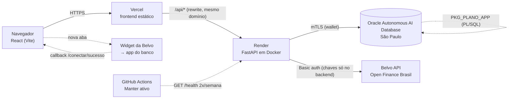

# Respira

> **Descubra quando você sai das dívidas.**
> Projeto do **Enterprise Challenge / Startup One** do curso de **Engenharia de Software da FIAP**
> (4º e último ano) — **Fase 7, MVP final**.

O Respira lê as dívidas de uma pessoa via **Open Finance** (pela [Belvo](https://belvo.com)),
calcula **quando ela fica livre delas** e propõe um plano de quitação que cabe no bolso.
A unidade de valor do produto é **uma data**, não um gráfico: todo app financeiro responde
"para onde foi meu dinheiro"; o Respira responde **"quando isso acaba"**.

## Acesse online

| | |
|---|---|
| **Aplicativo** | **https://app-respira-startupone.vercel.app** |
| API (saúde do serviço) | https://respira-api-qo4n.onrender.com/health |

Na página inicial (ou na tela de entrar), toque em **"Entrar como Juliana (demonstração)"**: cada visitante ganha uma
Juliana só sua, com dados fictícios, apagada depois de 24 horas. Dá para simular meses, ativar um
plano e reiniciar à vontade sem atrapalhar ninguém.

> O backend roda no plano gratuito do Render, que **dorme após 15 minutos sem uso**. O primeiro
> acesso depois disso pode levar cerca de um minuto para acordar; os seguintes são imediatos.

### Sobre este projeto

O Respira é o projeto da equipe abaixo para o **Enterprise Challenge / Startup One** do
**4º e último ano de Engenharia de Software da FIAP**. A Fase 5 validou o problema, a persona e
o modelo de dados (com o motor de plano em Oracle PL/SQL); a Fase 6 entregou o protótipo
funcional, integrado a dados bancários reais; esta **Fase 7** entrega o **MVP final**: publicado,
com o **Oracle Autonomous AI Database** como banco principal, o motor conferido em PL/SQL dentro do
Oracle, as correções da avaliação de usabilidade e as melhorias vindas do teste do MVP.

| Integrante | RM |
|---|---|
| André Lambert | 99148 |
| Gabriel Augusto Maciel Toledo | 551654 |
| Ruan Rocha | 551520 |
| Gustavo Kenzo | 98481 |
| Lorenzo Ferreira | 97318 |

---

## Sumário

1. [O problema](#1-o-problema)
2. [O que construímos](#2-o-que-construímos)
3. [Como rodar localmente](#3-como-rodar-localmente)
4. [Telas e como navegar](#4-telas-e-como-navegar)
5. [Roteiro de avaliação (5 minutos)](#5-roteiro-de-avaliação-5-minutos)
6. [Arquitetura](#6-arquitetura)
7. [Banco de dados: Oracle Autonomous AI Database](#7-banco-de-dados-oracle-autonomous-ai-database)
8. [Como publicar (Render + Vercel)](#8-como-publicar-render--vercel)
9. [Stack](#9-stack)
10. [O motor de plano](#10-o-motor-de-plano)
11. [Segurança e privacidade](#11-segurança-e-privacidade)
12. [Testes](#12-testes)
13. [Limitações atuais](#13-limitações-atuais)
14. [Próximos passos](#14-próximos-passos)
15. [Documentação e referências](#15-documentação-e-referências)

---

## 1. O problema

No Brasil, 82% das famílias estão endividadas (PEIC/CNC), 85% dessas dívidas estão no cartão
de crédito, e o rotativo cobra mais de 400% ao ano (BCB). O problema não é falta de informação —
é **ausência de horizonte**: a pessoa sabe que deve, mas não sabe *quanto no total*, *o que pagar
primeiro* e *quando isso acaba*.

A persona do projeto é a **Juliana Ramos** (fictícia, ancorada em dados públicos): 34 anos,
R$ 3.100 líquidos, dívidas espalhadas em três bancos e um carnê de loja. Na Fase 5, os números dela
mostraram a armadilha que o Respira existe para tornar visível: **os juros do mês (R$ 733) eram
maiores que a soma dos mínimos (R$ 723)** — pagando só o mínimo de tudo, a dívida crescia todo mês.

O contexto completo (pesquisa, persona, princípios, regras de negócio) está em
[`docs/contexto-produto.md`](docs/contexto-produto.md).

---

## 2. O que construímos

Um aplicativo web *mobile-first* (pensado para Android intermediário, telas de 360 px), com
backend próprio e banco **Oracle Autonomous AI Database** em São Paulo, publicado na internet. Roda
contra a **Belvo em produção** (dados bancários reais) e em um **modo demonstração** com a Juliana.

| Funcionalidade | O que faz | Situação |
|---|---|---|
| **F1 — Conexão de contas** | Autorização via widget da Belvo (Open Finance Brasil), aberto em nova aba; coleta de contas, cartões, faturas, empréstimos e transações, com uma tela de espera que mostra o progresso por banco e por etapa (e não cai se a conexão oscilar); revogação em um toque. Dívidas fora do Open Finance (carnê, crediário) entram por cadastro manual assistido. | ✅ |
| **F2 — Raio-X da dívida** | Total consolidado, lista ordenada por custo efetivo (taxa ao ano), data de quitação na mesma tela e o alerta de quando pagar só o mínimo faz a dívida crescer. | ✅ |
| **F3 — Plano de quitação** | Três estratégias lado a lado (Avalanche, Bola de neve, Equilibrado), diferença em reais e meses, *slider* de capacidade que move a data em tempo real. **Novo:** selo **"✓ Conferido no Oracle"** — o mesmo plano calculado também em PL/SQL dentro do banco, igual ao centavo — e o link **"Ver de onde veio"** que explica o valor mensal calculado. | ✅ |
| **F4 — Acompanhamento e alertas** | Eventos determinísticos (rotativo, atraso iminente, atraso, cheque especial, pico de gasto, desvio do plano, dívida quitada), previsto × realizado e marcos. **Novo:** alertas não se repetem e saem quando deixam de valer; **próximos vencimentos** no Início. | ✅ (dentro do app; sem push/e-mail) |
| **F5 — Microlições e copiloto** | 9 microlições estáticas casadas por regra com o evento. Copiloto de IA visível e desabilitado ("em breve"). | 🟡 Estrutura pronta; IA não implementada |
| **Finanças do dia a dia (PFM)** | Saldos por banco, faturas, extratos. **Novo:** **Todas as transações** com filtros, **Para onde foi o dinheiro** (gastos por subcategoria × média, ligado à data de saída), **entradas, gastos e dívida mês a mês**, **filtros e ordenação de dívidas**. Categorias pela **taxonomia V2 da Belvo**, em português ("Restaurantes e lanchonetes", "Bebidas e tabaco", "Mercado"), e **compras parceladas no cartão** com cada parcela no mês em que cai ("parcela 3/12"). | ✅ |

### O que mudou na Fase 7

| Bloco | Principais entregas |
|---|---|
| **Correções da avaliação da Fase 6** | Alertas que se acumulavam; "1ª dívida quitada" coerente com a ordem de pagamento; tela própria quando algo não carrega; datas iguais entre telas; rótulos da Belvo em português ("Mercado", "out/2026", "Itaú"); botão "Começar este plano" fixo; "venceu em"; na demo, contas e faturas avançam com os meses simulados. |
| **Oracle como banco principal** | python-oracledb com mTLS pela wallet, esquema criado na primeira subida, migrações nos dois bancos, dinheiro como `NUMBER`. A jornada da Juliana dá os mesmos números, ao centavo, no Oracle e no SQLite. |
| **Oracle como parte da estratégia** | Motor de quitação da Fase 5 em PL/SQL (`backend/oracle/pkg_plano_app.sql`) rodando sobre as tabelas do app; o selo "Conferido no Oracle" aparece só quando Python e PL/SQL coincidem. `/health` mostra banco, versão e região; card "Onde ficam os seus dados". |
| **Melhorias do teste do MVP** | Todas as transações (N1), gastos por categoria com a frase "sua data chegaria N meses antes" (N2), próximos vencimentos (N3), filtros de dívidas (N4), fluxo mensal e "de onde veio" (N5). |
| **Publicação** | Frontend na Vercel, backend em Docker no Render, demonstração por visitante, cabeçalhos de segurança, workflow que mantém o serviço ativo. |
| **Segurança** | CPF criptografado em repouso, limites de tentativa no cadastro e na demo, dependências sem vulnerabilidade alta ou crítica. |
| **Ajustes do teste com conta real** | Parcelas do cartão pelo `accounting_date` (data em que a parcela cai), com data da compra e número da parcela; taxonomia V2 da Belvo (16 categorias, ~80 subcategorias) com gasto essencial definido pela subcategoria; espera da coleta redesenhada e resistente a quedas de conexão; consulta à Belvo a cada 5 s. |

**Modo demonstração (Juliana).** Simula a jornada inteira com dados fictícios no **mesmo formato
de resposta da Belvo** (o mapeamento Belvo → domínio é exercitado de verdade): três bancos
conectados — Nubank (conta, cartão no rotativo e empréstimo pessoal), Itaú (conta no cheque
especial, cartão parcelado e financiamento de moto) e Caixa (poupança, consignado e um crédito
pessoal com parcela atrasada) —, um carnê de loja incluído à mão e 12 meses de transações. A tela
Início tem controles para **avançar um mês** (inclusive um "mês difícil") e **reiniciar**.

---

## 3. Como rodar localmente

### Pré-requisitos

| Ferramenta | Versão | Observação |
|---|---|---|
| [uv](https://docs.astral.sh/uv/) | recente | gerencia o Python do backend (3.13, de `backend/.python-version`) |
| Node.js | 20.19+ ou 22.12+ | exigência do Vite |
| Docker | opcional | para subir tudo com um comando |

### Passo a passo (SQLite, sem nenhuma credencial)

```bash
# 1) Configuração do backend (uma vez só)
cp backend/.env.example backend/.env

# 2) Backend — FastAPI + SQLite (cria o banco, aplica as migrações e semeia a Juliana ao subir)
cd backend
uv run uvicorn app.main:app --reload --port 8000

# 3) Frontend — em outro terminal
cd frontend
npm install
npm run dev
```

Abra **http://localhost:5173** e toque em **"Entrar como Juliana (demonstração)"** (localmente,
também dá para usar `juliana@respira.example` / `senha123`, que vêm de `DEMO_EMAIL`/`DEMO_SENHA`
do `.env.example` — persona fictícia, não é segredo). A documentação interativa da API fica em
http://localhost:8000/docs.

### Com Docker (um comando)

```bash
cp backend/.env.example backend/.env
docker compose up --build
```

Backend em http://localhost:8000 e frontend em http://localhost:5173. Nenhum segredo entra na
imagem: a configuração vem do `backend/.env` em tempo de execução.

### Com o Oracle

O banco é escolhido só pela configuração. Com um Autonomous AI Database e a wallet (veja a
[seção 7](#7-banco-de-dados-oracle-autonomous-ai-database)), preencha no `backend/.env`:

```dotenv
DATABASE_URL=oracle+oracledb://@
ORACLE_USER=RESPIRA_APP
ORACLE_PASSWORD=...            # nunca no Git
ORACLE_DSN=respira_tp          # alias do tnsnames.ora
ORACLE_CONFIG_DIR=/caminho/para/a/wallet   # tnsnames.ora + ewallet.pem, fora do repositório
ORACLE_WALLET_PASSWORD=...
ORACLE_REGIAO=sa-saopaulo-1
```

O script `ops/oracle/configurar_env.py` grava essas linhas a partir de `~/.oracle/respira/` sem
exibir as senhas. Para voltar ao SQLite sem editar o arquivo:
`DATABASE_URL=sqlite:///./respira.db uv run uvicorn app.main:app --reload --port 8000`.

### O que funciona para quem clona o repositório

| Cenário | Funciona? | Por quê |
|---|---|---|
| Conta demo (Juliana) | ✅ Sim, sem configurar nada além do passo 1 | Dados fictícios gerados pelo próprio backend |
| Criar uma conta nova | ✅ Sim | Cadastro, login e telas funcionam normalmente |
| Conectar um banco real | ❌ Não, sem chaves próprias | Exige `BELVO_SECRET_ID`/`BELVO_SECRET_PASSWORD` e `CPF_CHAVE`, que **não estão no repositório** |
| Usar o Oracle | ❌ Não, sem banco e wallet próprios | Credenciais e wallet nunca vão para o Git |

**Por que as chaves não estão no repositório.** O projeto tem acesso à Belvo em **produção** — as
chaves dão leitura a dados financeiros reais de quem conectar um banco. Elas, a senha e a wallet do
Oracle e a chave do CPF ficam só no `backend/.env` de quem desenvolve (ignorado pelo Git) e nas
variáveis secretas do Render.

### Testes

```bash
cd backend && uv run pytest     # 180 testes (177 no SQLite + 3 que só rodam no Oracle)
cd frontend && npm test         # 60 testes
python3 ops/oracle/testes_oracle.py   # a suíte do backend no schema de teste do Oracle
```

---

## 4. Telas e como navegar

### Navegação

- **Antes de entrar:** a página inicial (`/`) leva a **Entrar** (`/entrar`) ou **Criar conta**
  (`/cadastro`). As duas telas têm **"Entrar como Juliana (demonstração)"**.
- **Depois de entrar:** a barra fixa na parte de baixo leva a **Início · Contas · Raio-X · Dívidas ·
  Plano · Configurações**.
- **Primeira vez de uma conta nova:** Criar conta → Conectar banco → (autorização no banco, em
  nova aba) → Raio-X → Plano → Início.

### As telas

| Tela | Rota | Para que serve e como usar |
|---|---|---|
| **Página inicial** | `/` | O produto em três passos, o aviso "Este app não movimenta o seu dinheiro" e o atalho **Entrar como Juliana (demonstração)**. |
| **Entrar** | `/entrar` | E-mail e senha, ou **Entrar como Juliana (demonstração)**. |
| **Criar conta** | `/cadastro` | E-mail, senha, nome completo e CPF (só quando a conexão com a Belvo está ligada; gravado cifrado). Pergunta opcional sobre planos anteriores, que muda a estratégia sugerida. |
| **Conectar banco** | `/conectar` | O que é lido e o que não é feito; **Conectar outro banco** abre a autorização em nova aba e mostra o progresso da coleta. Na Juliana, a autorização é simulada. |
| **Início** | `/inicio` | A data em que você fica livre, quanto já foi pago, **O que fazer este mês**, **Próximos vencimentos**, alertas, dívidas quitadas e o mês a mês. Na Juliana, o painel **Modo demonstração** simula os meses. |
| **Contas** | `/contas` | Saldos por banco, faturas em aberto, **Ver todas as transações**, **Para onde foi o dinheiro** (gastos por subcategoria × média dos 3 meses — delivery separado do mercado —, com a frase que liga o corte à data de saída) e **Entradas, gastos e dívida, mês a mês**. |
| **Detalhe da conta** | `/contas/:id` | Conta: saldo e extrato com filtros. Cartão: faturas (atual e anteriores, "vence/venceu em") e extrato. |
| **Todas as transações** | `/transacoes` | Extrato de todas as contas: período, banco, tipo, categoria, busca, faixa de valor e **Só pagamentos de dívida**; resumo de entradas, saídas e resultado. Cada transação mostra a subcategoria e, nas compras parceladas no cartão, "parcela 3/12" (o detalhe traz a data da compra e quando a parcela cai). Filtros na URL (o botão voltar e o link compartilhado funcionam). |
| **Próximos vencimentos** | `/vencimentos` | Faturas e parcelas nos próximos 7, 15 ou 30 dias, com status (pago, pendente, atrasado) e, com plano ativo, o valor do plano. |
| **Raio-X** | `/raiox` | Quanto você deve, as dívidas da mais cara para a mais barata, a data de quitação, os juros do mês e o alerta do mínimo. |
| **Dívidas** | `/dividas` | Cada dívida com contrato, atraso e selos de estimativa; ordenar (ordem do plano, maior taxa, maior saldo, próximo vencimento, por banco) e filtrar (banco, tipo, situação). |
| **Plano** | `/plano` | *Slider* de capacidade, as três estratégias, **"Ver de onde veio"**, o selo **"✓ Conferido no Oracle"**, o gráfico da dívida mês a mês e **Começar este plano** (fixo no rodapé). |
| **Configurações** | `/configuracoes` | Seus dados (CPF mascarado), **Onde ficam os seus dados** (Oracle, São Paulo), bancos conectados, revogação, exclusão de conta. |
| **Incluir dívida** | `/dividas/nova` | Para carnê, crediário ou dívida com alguém. |
| **Conferir dívida** | `/dividas/:id` | Corrige parcela e taxa quando o banco não as informou. |
| **Microlição** | `/licoes/:slug` | Texto curto sobre o assunto de um alerta, aberto pelo link **Entenda**. |

---

## 5. Roteiro de avaliação (5 minutos)

Em **https://app-respira-startupone.vercel.app**, toque em **"Entrar como Juliana
(demonstração)"**. Os dados chegam em alguns segundos (a tela mostra o progresso).

1. **Raio-X** — "Você deve **R$ 20.183** em **8 compromissos**", o rotativo com **436% a.a.**, a data
   de quitação logo abaixo e o alerta de que o rotativo **cresce R$ 104 por mês** pagando só o mínimo.
2. **Plano** — com a capacidade calculada do histórico (**R$ 1.755/mês**): Avalanche em **16 meses**
   (R$ 7.727 de juros, 1ª dívida quitada no **5º mês**), Equilibrado em **17** (R$ 7.941), Bola de neve
   em **17** (R$ 9.258). Toque em **"Ver de onde veio"** para ver a conta do R$ 1.755 e note o selo
   **"✓ Conferido no Oracle"**. Arraste o *slider* e toque em **Começar este plano**.
3. **Início** — data de saída, o que pagar este mês e os próximos vencimentos. No painel **Modo
   demonstração**, simule um mês seguindo o plano e depois um mês difícil: a data é recalculada, sem
   linguagem de falha, e os alertas não se repetem.
4. **Contas** — em **Para onde foi o dinheiro**: *"Se delivery, streaming e lazer voltasse à sua
   média, sobrariam R$ 220 por mês — sua data de saída chegaria 2 meses antes"*. Toque na barra para
   ver as transações; volte e abra **Ver todas as transações** para experimentar os filtros.
5. **Dívidas** — ordene por **maior taxa** e filtre **Em atraso**.
6. **Configurações** — "Onde ficam os seus dados: Oracle Autonomous AI Database · São Paulo".

Para recomeçar, use **"Reiniciar demonstração"** no painel da tela Início.

---

## 6. Arquitetura



**Decisões principais:**

- **Existe um backend porque as chaves da Belvo nunca podem estar no navegador.** Toda chamada à
  Belvo sai do backend; o React só conversa com a nossa API.
- **Mesmo domínio para o navegador.** O frontend chama `/api/...` e a Vercel repassa ao Render
  (`frontend/vercel.json`). O cookie de sessão fica `HttpOnly; Secure; SameSite=Lax`, sem CORS aberto.
- **O widget abre em nova aba, não em `iframe`** (bancos bloqueiam ser enquadrados). A aba original
  fica sabendo do resultado por `BroadcastChannel` **e** por consulta ao backend.
- **Coleta por polling, webhooks opcionais.** Sem webhook configurado, o backend consulta a Belvo a
  cada 5 s (por até 10 minutos) até os dados chegarem; com webhook (autenticado e idempotente), ele
  assume. A tela de espera consulta o nosso backend a cada 5 s e não cai se a conexão oscilar.
- **Taxonomia da Belvo em um lugar só.** Os nomes da Belvo (categorias, subcategorias, tipos de
  produto) só aparecem em `providers/mapping.py` (regras) e `frontend/src/lib/copy.ts` (tradução).
- **Provedor por usuário.** A conta demo usa o `FixtureProvider` (dados fictícios no formato da
  Belvo); toda conta registrada usa o `BelvoProvider`.
- **Camadas com responsabilidades fechadas:**

```
backend/app/
├── domain/        regras de negócio em Python puro, sem I/O (plano, Raio-X, eventos, vencimentos, gastos)
├── providers/     Belvo real, fixture da Juliana e mapping.py — único lugar que conhece os nomes da Belvo
├── repositories/  única camada que conhece SQL (inclui oracle.py: pacote PL/SQL e versão do banco)
├── services/      orquestração (coleta, conexão, autenticação, demo, criptografia do CPF)
├── routers/       endpoints HTTP (42)
└── models/        tabelas (SQLModel) e tipos que funcionam no SQLite e no Oracle
backend/oracle/    pkg_plano_app.sql — o motor de quitação em PL/SQL
backend/migrations Alembic (vale nos dois bancos)
ops/oracle/        scripts para operar o Oracle pela OCI CLI (sem segredos)

frontend/src/
├── routes/        uma pasta por tela
├── components/    interface e componentes do domínio (Money, LogoBanco, gráficos, listas)
└── lib/           cliente da API validado com Zod, dinheiro em centavos, datas, filtros, textos (copy.ts)
```

---

## 7. Banco de dados: Oracle Autonomous AI Database

| | |
|---|---|
| Serviço | Oracle Autonomous AI Database, **Always Free**, Transaction Processing |
| Versão | 23.26 (26ai) |
| Região | São Paulo (`sa-saopaulo-1`) |
| Conexão | python-oracledb em **modo thin**, **mTLS pela wallet** (só `tnsnames.ora` e `ewallet.pem`; sem Instant Client) |
| Schemas | `RESPIRA_APP` (aplicação) e `RESPIRA_TESTE` (suíte de testes), com privilégios mínimos e cota |
| Tabelas | 17 (16 do modelo + `ALEMBIC_VERSION`) |

**Como o app usa o Oracle:**

- **Esquema criado na primeira subida.** Banco novo → o esquema é criado a partir dos modelos e
  marcado na versão atual do Alembic; dali em diante, as migrações rodam nos dois bancos.
- **Dinheiro como `NUMBER`** (exato, sem arredondar) e o restante dos tipos compatível com os dois
  bancos — `backend/tests/test_oracle_ddl.py` compila o DDL de todas as tabelas para o Oracle.
- **O motor de quitação em PL/SQL.** `backend/oracle/pkg_plano_app.sql` é o `PKG_PLANO` da Fase 5
  adaptado às tabelas do app, instalado a cada subida (`CREATE OR REPLACE`).
  `GET /plano/conferencia-oracle` roda o plano em Python e em PL/SQL; a tela mostra
  **"✓ Conferido no Oracle"** só quando coincidem. Na Juliana, as três estratégias coincidem ao centavo.
- **`/health`** faz uma consulta real e devolve banco, versão e região — é o que o workflow
  "Manter ativo" usa para o Always Free não parar por inatividade.

**Operação (OCI CLI).** `ops/oracle/` tem os scripts para validar a sessão da CLI, descobrir o
banco, ver o estado, ligar/desligar, baixar e rotacionar a wallet (`respira_oci.sh`), criar os
usuários e listar/contar tabelas (`respira_sql.py`), gravar o `backend/.env` sem exibir senhas
(`configurar_env.py`) e rodar a suíte no schema de teste (`testes_oracle.py`). As senhas ficam em
`~/.oracle/respira/` (fora do repositório) e nunca aparecem na tela.

---

## 8. Como publicar (Render + Vercel)

**Backend — Render** (Blueprint em [`render.yaml`](render.yaml)):

1. No painel do Render, **New → Blueprint** e escolha o repositório (branch `main`).
2. Preencha as variáveis secretas: `ORACLE_PASSWORD`, `ORACLE_WALLET_PASSWORD`, `APP_PUBLIC_URL`
   (a URL da Vercel), `CPF_CHAVE` e, para conexão real, `BELVO_SECRET_ID` e `BELVO_SECRET_PASSWORD`.
3. Em **Environment → Secret Files**, suba `tnsnames.ora` e `ewallet.pem` (ficam em `/etc/secrets`).
4. Deploy e confira `https://<serviço>.onrender.com/health` → `"banco": "oracle"`.

**Frontend — Vercel:**

1. **Add New → Project**, o mesmo repositório, **Root Directory: `frontend`** (Vite é detectado).
2. Sem variáveis: o build já usa `VITE_API_URL=/api` (`frontend/.env.production`).
3. Em `frontend/vercel.json`, o *rewrite* `/api/*` aponta para a URL do serviço no Render.

**Manter ativo:** o workflow [`.github/workflows/manter-ativo.yml`](.github/workflows/manter-ativo.yml)
faz `GET /health` às segundas e quintas (o Oracle Always Free para após 7 dias sem uso).

**Variáveis da versão publicada:**

| Variável | Valor | Para quê |
|---|---|---|
| `DATABASE_URL` | `oracle+oracledb://@` | usar o Oracle |
| `ORACLE_*` | usuário, DSN, `/etc/secrets`, região, pool 3 | conexão (senhas como secretas) |
| `DEMO_POR_VISITANTE` | `true` | uma Juliana por visitante, apagada em 24 h |
| `MODO_PUBLICO` | `false` | `true` desliga a Belvo e o CPF (vitrine só com demo) |
| `CPF_CHAVE` | chave Fernet (secreta) | CPF cifrado em repouso |
| `BELVO_SECRET_ID` / `BELVO_SECRET_PASSWORD` | secretas | conexão real com bancos |
| `APP_PUBLIC_URL` | `https://app-respira-startupone.vercel.app` | callbacks do widget e CORS |

---

## 9. Stack

| Camada | Tecnologia |
|---|---|
| Frontend | React 18 + TypeScript (strict), Vite, Tailwind CSS, React Router, TanStack Query, React Hook Form + Zod, Recharts (carregado sob demanda), date-fns (pt-BR) |
| Backend | Python 3.13, FastAPI, SQLModel/SQLAlchemy, Alembic, Pydantic v2, pydantic-settings, httpx, argon2-cffi, python-oracledb, cryptography |
| Banco | **Oracle Autonomous AI Database** (produção) · SQLite (desenvolvimento e testes) |
| Oracle | PL/SQL (`PKG_PLANO_APP`), OCI CLI, wallet mTLS |
| Publicação | Vercel (frontend), Render com Docker (backend), GitHub Actions |
| Integração | Belvo — Open Finance Brasil (OFDA) |
| Testes | pytest (backend), Vitest + Testing Library (frontend) |

**Dinheiro nunca é float.** O backend usa `Decimal` (`NUMBER` no Oracle, texto exato no SQLite) e o
frontend trabalha em centavos inteiros.

**Bundle inicial:** 120 KB gzip (orçamento: 250 KB). Cada tela é um pedaço carregado sob demanda.

---

## 10. O motor de plano

O núcleo do produto (`backend/app/domain/planner.py`) é um **porte fiel** do pacote PL/SQL
`PKG_PLANO` validado na Fase 5:

1. **Capacidade de pagamento** — calculada do histórico: mediana das entradas menos mediana dos
   gastos essenciais dos últimos 6 meses, **com 10% de reserva** para imprevistos. A tela
   "Ver de onde veio" mostra essa conta mês a mês. "Essencial" é decidido pela subcategoria da
   taxonomia V2 da Belvo (`mapping.ESSENCIAIS_V2`): mercado, contas da casa, farmácia, saúde,
   educação e transporte do dia a dia sim; restaurante, delivery, bebida e viagem não.
2. **Ordenação por estratégia** — Avalanche (maior taxa primeiro), Bola de neve (menor saldo
   primeiro) ou Equilibrado (a menor dívida primeiro e depois por taxa).
3. **Simulação mês a mês** — juros antes do pagamento, arredondados a cada mês; paga-se o mínimo de
   tudo e a sobra vai inteira para a dívida da vez.

**Duas execuções, um resultado.** O mesmo algoritmo existe em PL/SQL dentro do Oracle
(`backend/oracle/pkg_plano_app.sql`). `test_planner.py` reproduz **ao centavo** os números publicados
na Fase 5 (18 / 19 / 21 meses), e `test_oracle_motor.py` confere Python × PL/SQL nas três estratégias,
inclusive com capacidade insuficiente e depois de meses simulados.

A estratégia pré-selecionada é Avalanche — ou Equilibrado para quem já desistiu de um plano antes —,
decisão marcada como provisória no código porque veio de uma pesquisa com 10 respostas.

---

## 11. Segurança e privacidade

- **Nenhum segredo no código, no Git ou na imagem Docker.** Chaves da Belvo, senhas e wallet do
  Oracle e a chave do CPF ficam no `backend/.env` (ignorado) e nas variáveis/arquivos secretos do
  Render. O `.dockerignore` deixa de fora `.env`, banco local e wallet.
- **CPF criptografado em repouso** (Fernet, chave `CPF_CHAVE` só no ambiente) e um hash com chave para
  saber se já está em uso sem decifrar. Sem a chave, o cadastro com CPF é recusado. O CPF aparece
  sempre mascarado e nunca vai para log.
- **Senhas com argon2id**; sessão em cookie `HttpOnly; Secure; SameSite=Lax`, token guardado só como
  hash; **limites de tentativa** no login, no cadastro e na criação de demos (por IP).
- **Cabeçalhos de segurança** na Vercel: CSP restrita, HSTS, `X-Frame-Options`, `nosniff`,
  `Referrer-Policy`, `Permissions-Policy`; `noindex` (não aparece em buscadores).
- **CORS restrito** e cabeçalho obrigatório nas requisições de escrita (proteção contra CSRF).
- **Nenhuma chamada à Belvo parte do navegador**; webhook autenticado e idempotente.
- **Minimização de dados**: só as quatro permissões que o produto usa; do cartão, só o final.
- **Revogação real**: desconectar um banco apaga o vínculo na Belvo **e** os dados locais; a pessoa
  pode excluir a própria conta. Demos de visitante são apagadas com todos os dados em 24 h.
- **Dependências auditadas**: `npm audit` e `pip-audit` sem vulnerabilidade conhecida.

---

## 12. Testes

| Suíte | Quantidade | O que cobre |
|---|---:|---|
| `test_mapping.py` | 49 | Belvo → domínio: modalidades, taxa de juros (inclusive pelo CET), cheque especial, contratos, faturas, transações, fuso horário, nome curto do banco, parcelas do cartão pelo `accounting_date`, essencial pela subcategoria V2 |
| `test_oracle_ddl.py` | 36 | O esquema compila para o Oracle; PK com IDENTITY; dinheiro como `NUMBER` (e ida e volta exata, no Oracle) |
| `test_planner.py` | 20 | Os números da Fase 5 ao centavo, empates, uma dívida, capacidade insuficiente, sem dívidas |
| `test_api.py` | 13 | Jornada da Juliana, autenticação, isolamento entre usuários, webhooks, `/health`, `/config` |
| `test_transacoes.py` | 14 | Todas as transações: cada filtro (inclusive por subcategoria), somas, paginação, parâmetros inválidos, isolamento, parcelas da demo uma por mês |
| `test_alertas.py` | 12 | Alertas não se repetem e saem quando deixam de valer; conta nomeada; cheque especial atual |
| `test_gastos.py` | 8 | Gastos por categoria, impacto no plano, fluxo mensal coerente com a capacidade |
| `test_vencimentos.py` | 7 | Próximos vencimentos: datas, janela, status, cartão sem duplicar |
| `test_belvo.py` + `test_instituicoes.py` | 8 | Cliente da Belvo (payload, paginação, erros) e catálogo de bancos |
| `test_cpf_cifrado.py` | 5 | CPF nunca em texto no banco, "em uso" pelo hash, sem chave não grava, legado cifrado |
| `test_publicacao.py` | 4 | Demo por visitante isolada, limites, limpeza, versão pública |
| `test_consistencia.py` + `test_oracle_motor.py` | 4 | Mesma data e total entre telas; Python × PL/SQL (no Oracle) |
| **Backend** | **180** | 177 rodam no SQLite; 3 só no Oracle (`@pytest.mark.oracle`) |
| **Frontend (Vitest)** | **60** | Dinheiro, datas, textos e taxonomia, cadastro, filtros na URL (transações e dívidas), vencimentos, gastos, telas de erro |

A suíte do backend também roda contra o Oracle, no schema `RESPIRA_TESTE`
(`python3 ops/oracle/testes_oracle.py`). Na última rodada completa no Oracle, depois do motor em
PL/SQL, **137 testes passaram** e nenhum falhou; os testes das telas novas foram rodados no SQLite.

---

## 13. Limitações atuais

**Da publicação:**

- **Planos gratuitos.** O Render dorme após 15 minutos sem uso (~1 minuto para acordar) e fica nos
  EUA (Virginia, a região gratuita mais próxima de São Paulo); o Oracle Always Free tem sessões e
  espaço limitados (por isso o limite de demos ativas).
- **A conexão real com bancos está ligada na versão publicada**, para demonstração. Quem conectar um
  banco ali tem os dados guardados no Oracle da equipe (CPF cifrado). É uma decisão consciente para a
  apresentação, que contraria a orientação inicial de manter a versão pública só com dados fictícios.
- **Uma instância do backend.** Coleta e limites de tentativa vivem em memória; escalar para mais de
  uma instância exigiria movê-los para o banco.

**Do produto e dos dados:**

- **O Open Finance só traz o que a pessoa conectar.** Ficam de fora carnês, dívidas com pessoas e
  dívidas já cedidas a empresas de cobrança — o cadastro manual cobre parte disso.
- **Taxas de juros nem sempre vêm.** Quando a Belvo não traz a taxa, o sistema usa a do contrato pelo
  CET ou uma referência por modalidade — sempre com selo de **estimada** na interface.
- **Parcelas de empréstimo:** o Open Finance não informa se a parcela do mês já foi paga; em
  "Próximos vencimentos" elas ficam "pendente" até vencer.
- **Parcelas futuras do cartão** não entram no extrato "Tudo" (que vai até hoje) nem nos totais;
  para vê-las, escolha datas futuras em "Escolher datas". Uma visão própria de "parcelas a vencer"
  ainda não existe.
- **Dados já coletados se reorganizam na próxima sincronização** (botão **Atualizar**, em Contas):
  categorias, essenciais e datas de parcela são calculados quando os dados chegam da Belvo.
- **Alertas só dentro do app** — sem push nem e-mail. **Copiloto de IA não implementado.**
- **Pesquisa de validação com n=10, fora do público-alvo.** Decisões derivadas dela estão marcadas
  como provisórias. O teste do MVP da Fase 7 foi simulado com personas (método descrito no documento).

---

## 14. Próximos passos

| Item | Por quê |
|---|---|
| **Copiloto de IA (F5)** | Perguntas em linguagem natural sobre a própria dívida, via serviços de IA da OCI, com os dados na mesma instância. |
| **JSON Relational Duality View** | Servir o Raio-X a partir de uma Duality View no Oracle, como na Fase 5. |
| **Webhooks em produção** | Com a URL pública, receber as atualizações da Belvo em vez de *polling*. |
| **Notificações** | Push para alertas que passem na regra de parcimônia (ação concreta + valor em reais). |
| **Registrato (Banco Central)** | Orientar a consultar o relatório de operações de crédito no CPF e conectar todos os bancos. |
| **Teste com usuários do público-alvo** | Validar com pessoas endividadas de baixa renda, que a pesquisa da Fase 5 não alcançou. |

Fora do escopo por decisão de produto (Fase 5): renegociação dentro do app, marketplace de
crédito, iniciação de pagamento, investimentos, score de crédito e categorização manual de gastos.

---

## 15. Documentação e referências

| Documento | Conteúdo |
|---|---|
| [`docs/contexto-produto.md`](docs/contexto-produto.md) | Especificação completa: persona, pesquisa, princípios, regras de negócio, integração Belvo, modelo de dados, critérios de aceite. As referências `§N` no código apontam para ela. |
| [`CLAUDE.md`](CLAUDE.md) | Instruções para o agente de IA (Claude Code) usado no desenvolvimento. |
| [`backend/oracle/pkg_plano_app.sql`](backend/oracle/pkg_plano_app.sql) | O motor de quitação em PL/SQL. |
| [`ops/oracle/`](ops/oracle/) | Scripts de operação do Oracle pela OCI CLI. |
| [Vídeo da Fase 5](https://youtu.be/SqLT0RcDZTg) | Apresentação do conceito e da validação. |
| [Documentação da Belvo](https://developers.belvo.com/products/aggregation_brazil/aggregation-brazil-introduction) | Open Finance Brasil (OFDA). |

**Sobre o uso de IA no desenvolvimento.** O código foi escrito com apoio de um agente de IA
(Claude Code), guiado pela especificação em `docs/contexto-produto.md`. Todo código gerado passa por
revisão humana da equipe antes do merge (pull requests no GitHub).

**Avisos de integridade.** A persona Juliana é fictícia. A pesquisa primária teve 10 respostas e
não alcançou o público-alvo (baixa renda, alto endividamento); as conclusões derivadas dela são
provisórias. As projeções do Respira são projeções, não garantias, e o produto organiza e
projeta — não recomenda contratar nem deixar de contratar crédito.

---

**FIAP · Engenharia de Software (4º ano) · Enterprise Challenge / Startup One · Fase 7 — MVP final**
